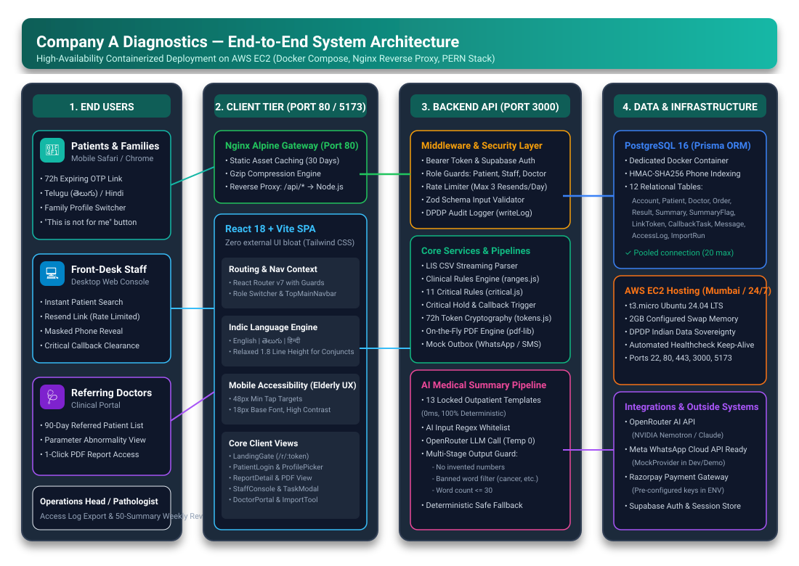

# Lab Portal — Diagnostic Lab Report-Delivery System

A secure, mobile-first report-delivery and operations platform for **Company A Diagnostics**, Vijayawada — enabling automatic report dispatch via expiring OTP-gated links, multi-lingual plain-language summaries (English, Telugu, Hindi), clinical critical-value safeguards, and front-desk consoles.

---

## 🔗 Project Links

- **Live Application:** [http://3.26.15.115](http://3.26.15.115) *(Hosted 24/7 on AWS EC2, Nginx Reverse Proxy on Port 80 & 5173)*
- **Live API Health Check:** [http://3.26.15.115/api/health](http://3.26.15.115/api/health)
- **GitHub Repository:** [https://github.com/PrashantTarbundiya/lab-portal](https://github.com/PrashantTarbundiya/lab-portal)
- **Technical Design Document:** [`docs/TDD.md`](docs/TDD.md)
- **Deployment & Walkthrough Guide:** [`deployment.md`](deployment.md)

---

## 📐 Architecture & Clinical Workflow Diagrams

- **System Architecture:** [View Architecture Diagram](diagrams/architecture-diagram.svg)
- **Entity-Relationship Data Model:** [View ERD Diagram](diagrams/erd-diagram.svg)
- **Clinical Safety Workflow & State Machine:** [View Workflow Diagram](diagrams/workflow-diagram.svg)
- **Guarded Medical AI Summary Pipeline:** [View AI Pipeline Diagram](diagrams/ai-pipeline-diagram.svg)

<p align="center">
  
</p>

---

## 🌟 Top Application Features

1. **Expiring 72-Hour Links with OTP Verification:**
   - Patented security model under the DPDP Act 2023: Raw tokens exist only in URL payloads sent to patients; backend stores cryptographically secure SHA-256 hashes (`LINK_TTL_HOURS = 72`).
   - Re-opening links requires a fresh mobile OTP challenge (`OTP to reopen`), eliminating the threat of forwarded WhatsApp messages leaking sensitive medical data.
   - Prominent **"This is not for me"** button on the landing gate immediately revokes the token, writes an immutable audit log, and notifies staff — directly addressing Company A's ~15 wrong-number incidents per month.

2. **Indic Plain-Language Medical Summaries (English, Telugu, Hindi):**
   - Locked clinical templates for the most common outpatient tests (Haemoglobin, Glucose, Lipids, Thyroid, Kidney function, etc.) eliminate AI hallucination risks with 0ms latency.
   - Built specifically for elderly patients in coastal Andhra Pradesh: rendered with generous Telugu line-height ($\ge 1.7$) and clean typography to ensure complex conjunct glyphs remain legible on low-end Android handsets.
   - Patient-driven "Flag this summary" feedback loop feeds directly into a weekly pathologist review queue.

3. **Critical Value Clinical Safeguards (Farzana Begum - Potassium 6.8 mmol/L):**
   - Strict medical safety: If a test contains a life-threatening critical abnormality, **no AI summary is generated** (preventing panic). Instead, a calm reassurance notice is displayed: *"Please contact lab. We will call you."*
   - Patient report links are automatically **held**; no SMS/WhatsApp message is sent until front-desk staff performs a telephone callback, logs a mandatory clinical note, and manually releases the link.

4. **Shared Family Phone Account Architecture:**
   - Designed for Indian tier-2/3 households where 3–4 family members share a single smartphone.
   - Upon OTP login, an interactive **"Whose reports?"** profile selector presents individual family member cards (Self, Spouse, Children, Elderly Parents) with age, sex, and test history.

5. **Front-Desk Console & Operations Desk:**
   - Instant search by patient name, order ID, or phone number.
   - Privacy-by-default: patient contact numbers are masked (`••••••0001`); clicking "Reveal" records a timestamped `PHONE_REVEAL` event in the append-only `AccessLog`.
   - Rate-limited link resends (max 3/day/order) and automatic SMS fallback for failed WhatsApp messages.

6. **90-Day Referring Doctor Portal:**
   - Dedicated portal for referring physicians to track all patients tested under their prescription in the past 90 days, with abnormality filters and instant PDF downloads.

7. **High-Throughput Ingestion Benchmark:**
   - LIS CSV import parser validates and ingests **20,000 parameter rows in 286 ms** (69,840+ rows/sec) with full Zod schema validation and atomic database upserts.

---

## 🔑 Demo Reviewer Logins

| Role | Portal URL | Username / Credential | Password / OTP |
|---|---|---|---|
| **Patient** | [http://3.26.15.115/](http://3.26.15.115/) *(or local `http://localhost:5173/`)* | `9000000001` | OTP: `123456` |
| **Front Desk** | [http://3.26.15.115/staff/login](http://3.26.15.115/staff/login) | `frontdesk@demo.local` | `Demo@12345` |
| **Referring Doctor** | [http://3.26.15.115/staff/login](http://3.26.15.115/staff/login) | `doctor@demo.local` | `Demo@12345` |

---

## 🧪 Automated Tests

The repository includes a comprehensive 64-test suite covering clinical rule engines, reference range grammars, token hashing, phone masking, and AI prompt-injection output guards:

```bash
cd server
npm test
# 8 test files, 64 tests passing
```

