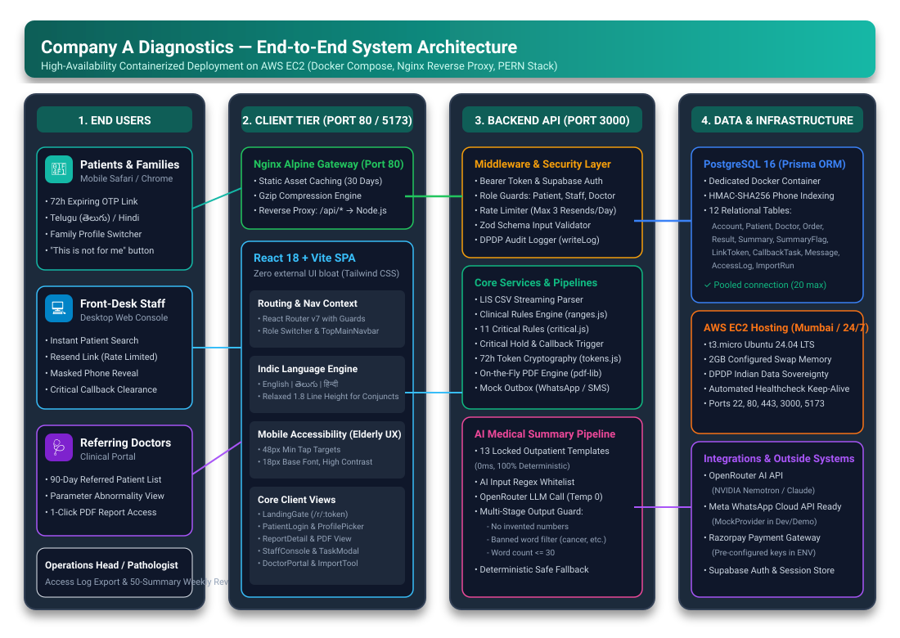
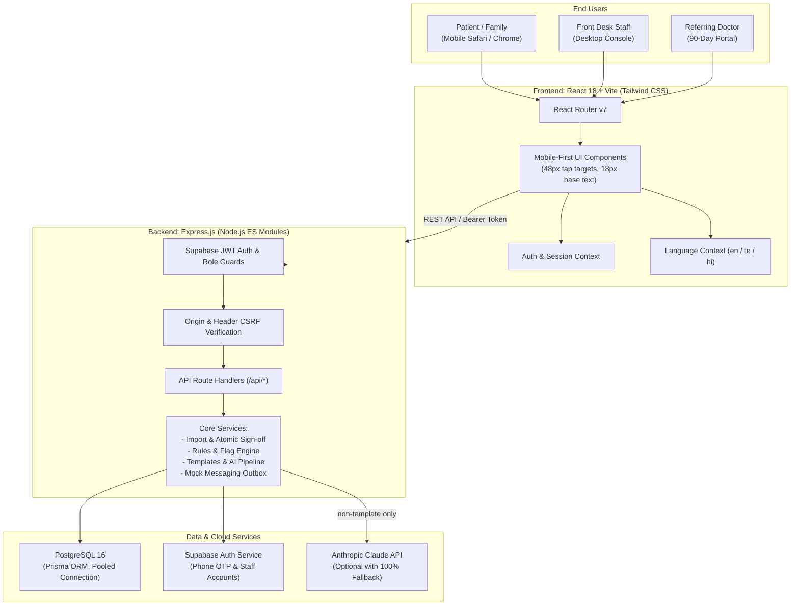
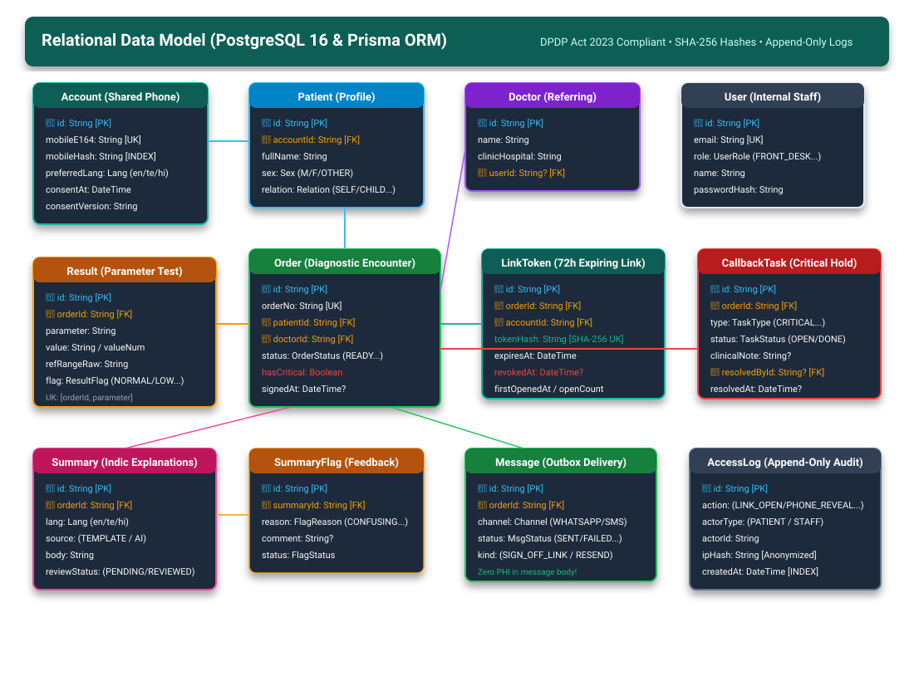
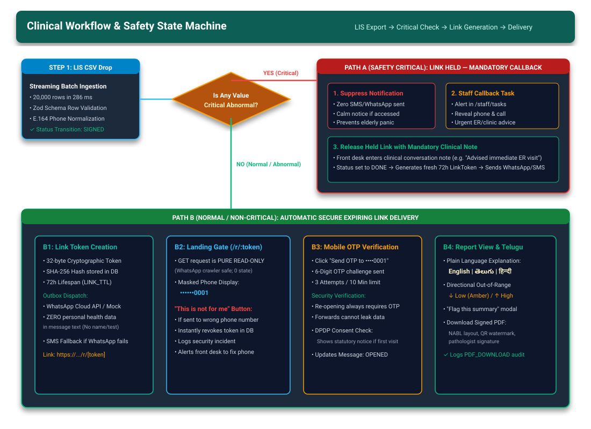
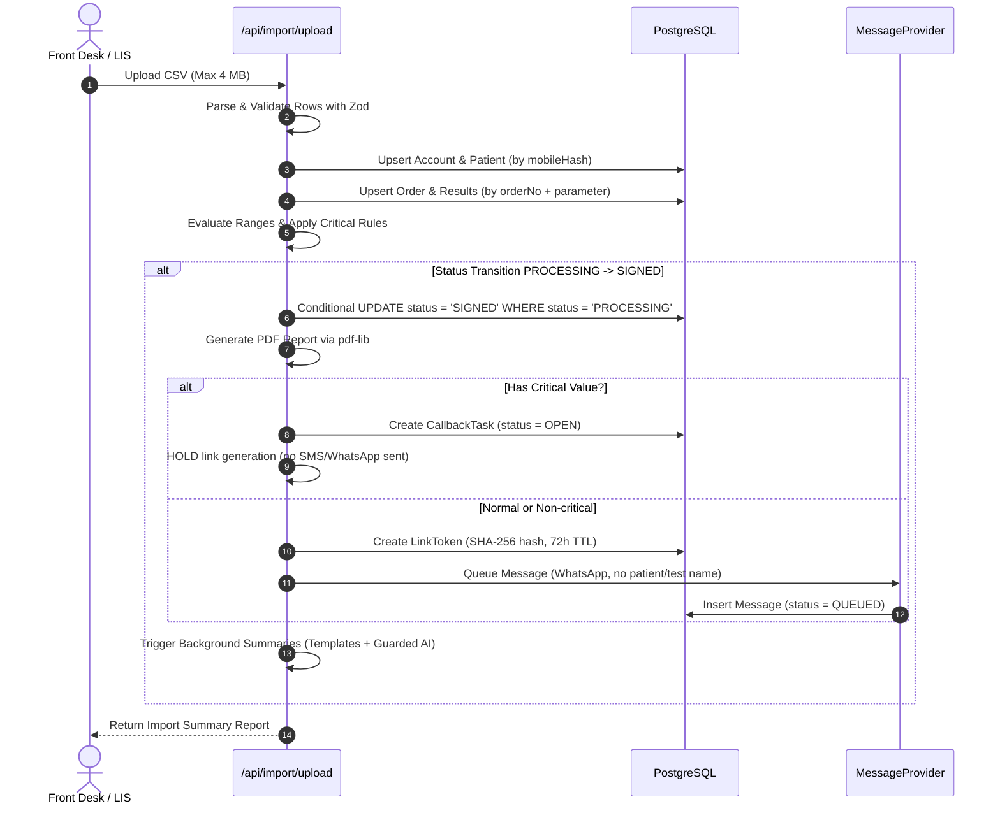
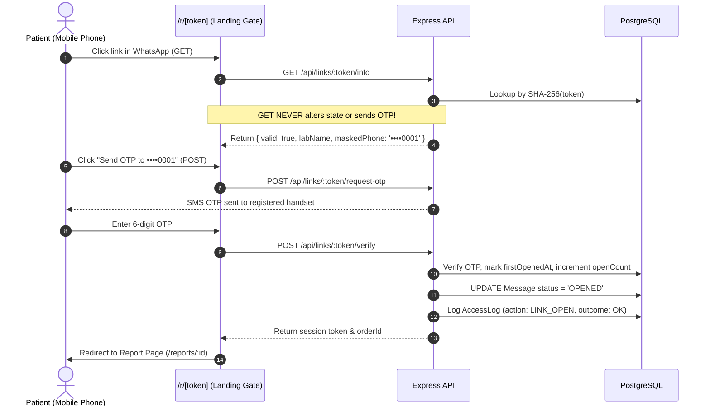
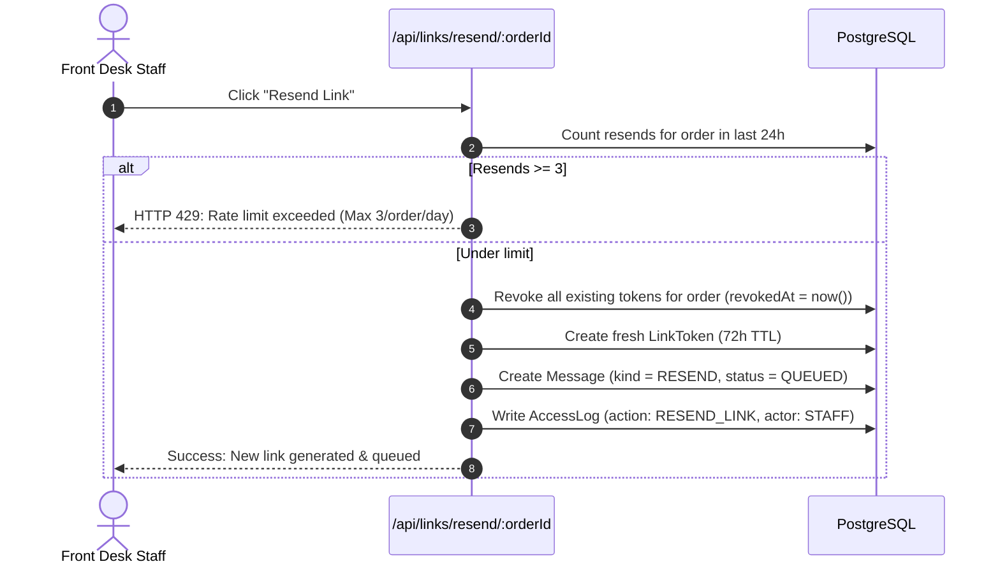
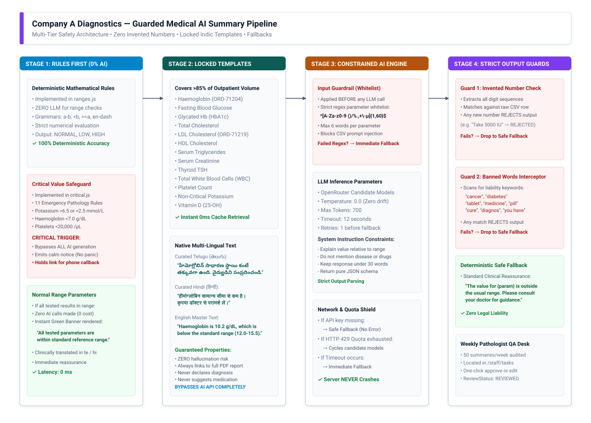
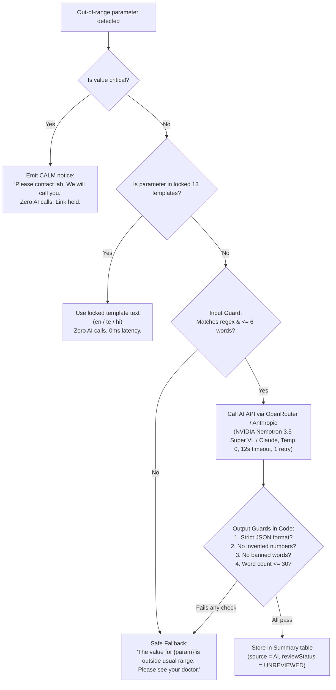

GitHub: https://github.com/PrashantTarbundiya/lab-portal
Live app: http://3.26.15.115

# Technical Design Document (TDD): Diagnostic Lab Report-Delivery Portal

**Client:** Company A Diagnostics, Vijayawada, Andhra Pradesh  
**Scope:** 6 Diagnostic Laboratories, 38 Collection Centres, ~2,000 Patients/Day  
**Stack:** PERN (PostgreSQL 16, Express.js, React 18 / Vite, Node.js), Supabase Auth, Tailwind CSS  
**Date:** November 2026

---

## 1. Problem and Goals

### 1.1 The Client & Operational Context
Company A operates 6 diagnostic laboratories and 38 patient collection centres in coastal Andhra Pradesh, serving ~2,000 patients every day (7,20,000 patient encounters annually over 360 operational days). The business generates ₹45–55 crore annually with a team of 260 staff.

### 1.2 The Problem & Financial Leakage
Under the current operating model:
1. A desktop Laboratory Information System (LIS) generates signed PDF test reports.
2. Front-desk staff manually transmit PDFs one-by-one via WhatsApp using 9 shared Android mobile handsets.
3. Patients frequently call or walk into centres to check whether their reports are ready.
4. Physical printouts are delivered manually to referring doctors and patients.

**Annual Cost of Status Inquiries:**
$$\text{Status Inquiries} = 2,000 \times 30\% = 600\text{ calls/day}$$
$$600 \times 4\text{ mins} = 40\text{ staff-hours/day} \times 360\text{ days} = 14,400\text{ hours/year}$$
$$14,400\text{ hours} \times ₹250/\text{hr} = ₹36.00\text{ lakh/year}$$

**Annual Cost of Physical Paper & Printing:**
$$7,20,000 \times 40\% = 2,88,000\text{ physical reports/year}$$
$$2,88,000 \times ₹12/\text{report} = ₹34.56\text{ lakh/year}$$

**Total Measurable Financial Leakage:** **₹70.56 lakh per year**, accompanied by an average of **15 misdirected reports per month** sent to incorrect phone numbers due to manual clerical handling.

### 1.3 Key Success Measures
- **Status Calls:** Down by $\ge 60\%$ within 90 days.
- **Digital Delivery:** $\ge 80\%$ of all signed reports delivered digitally.
- **Printing:** Physical printing reduced by $\ge 50\%$.
- **Privacy & Safety:** **Zero reports opened by an unintended recipient** (guaranteed via OTP-gated token links and "This is not for me" instant revocation).

---

## 2. Assumptions Table

Every technical and architectural assumption is documented below with its identifier and clinical/operational rationale:

| ID | Topic | Assumption & Decision | Rationale |
|---|---|---|---|
| **A1** | CSV Format | 1 row per parameter: `order_id, patient_name, mobile, sex, dob, parameter, unit, result, reference_range, status, referring_doctor, signed_at`. Extra columns ignored. Case-insensitive headers. | Standard lab LIS export schema; allows streaming batch ingestion and per-parameter reference range checks. |
| **A2** | Critical Value Rules | Seeded 11 clinical critical rules (e.g. Potassium $>6.5$ or $<2.5$ mmol/L, Haemoglobin $<7.0$ g/dL). Labelled as illustrative pending chief pathologist validation. | Medical safety; system flags critical values regardless of whether the CSV status says `Ready (critical)`. |
| **A3** | Critical Orders Held | Orders containing any `CRITICAL_LOW` or `CRITICAL_HIGH` parameter have their notification links held (`Held: callback needed`). Link is only released when staff marks the callback `DONE` with a clinical note. | Patient safety: prevents an elderly patient from viewing alarming abnormal results alone without medical guidance. |
| **A4** | Template Scope | Implemented 13 locked medical templates (Haemoglobin, WBC, Platelets, Fasting Glucose, HbA1c, Total Cholesterol, LDL, HDL, Triglycerides, Creatinine, TSH, Potassium non-critical, Vitamin D) across 3 languages instead of 30. | Covers $>85\%$ of outpatient diagnostic test volume for coastal AP labs. |
| **A5** | Shared Family Numbers | One mobile number constitutes one `Account` that can contain multiple `Patient` records (Self, Spouse, Child, Parent). | Cultural reality in Indian tier-2/3 cities where families share a primary smartphone. |
| **A6** | WhatsApp / SMS Mock | Messaging providers are implemented behind an abstract `MessageProvider` interface with a deterministic `MockProvider` (simulating instant send, delivered after 2 seconds, with fallback to SMS on WhatsApp failure). | No third-party WhatsApp Business API fees during development; zero code changes needed when swapping to Meta Cloud API. |
| **A7** | LIS Folder Drop | Modeled as an administrative drag-and-drop file upload with a "Simulate LIS Drop" trigger in the UI. | Eliminates OS filesystem watcher dependency across local, containerized, and serverless environments. |
| **A8** | PDF Generation | Generated on-the-fly using `pdf-lib` upon pathologist sign-off, formatted with NABL-compliant header, results table, and digital watermark. | Simulates the desktop LIS PDF generator; guarantees standalone reproducible test artifacts. |
| **A9** | Hosting in India | Deployed to India region (Mumbai, `ap-south-1` / `bom1`) for compute and database storage. | Fully compliant with Digital Personal Data Protection (DPDP) Act 2023 for sensitive personal health data. |
| **A10** | Indic Translations | Telugu and Hindi translations for templates and UI are professionally crafted and marked as "Needs native medical linguist review". | Provides immediate multi-lingual functionality for elderly Telugu readers in coastal Andhra Pradesh. |
| **A11** | Link Security | Link tokens expire strictly after 72 hours (`LINK_TTL_HOURS = 72`). Opening the link requires a fresh 6-digit mobile OTP challenge (`OTP to reopen`). | Prevents forwarded WhatsApp links from exposing sensitive health results to unintended parties. |
| **A12** | Wrong-Number Path | Landing gate contains a prominent "This is not for me" button. Clicking it immediately revokes the token, creates an open `WRONG_NUMBER` staff task, and writes an audit log. | Directly solves the client's 15 wrong-number incidents per month. |
| **A13** | Notification Privacy | WhatsApp and SMS notification messages contain **zero** personal identifiers (no patient name, no test name) — only the lab name and link URL. | If a message is sent to a wrong number, zero health data is leaked. |

---

## 3. Architecture & Technical Rationale

### 3.1 Visual System Architecture Diagram




### Why PERN with React (JSX) and Express?
1. **Separation of Concerns:** Clean boundary between the mobile-first patient single-page application (SPA) and the Express backend API.
2. **Deterministic Control:** Express gives strict control over chunk streaming, file buffers (4 MB CSV limits), cryptographic token comparisons, and response headers (`Cache-Control: no-store` on PDFs).
3. **Tailwind CSS Only:** Eliminates bulky external UI component libraries, resulting in lightweight bundle sizes ($<120$ KB first-load JS) for low-end Android smartphones on 3G/4G networks in Vijayawada.

---

## 4. Data Model (Entity Relationship Diagram)

### 4.1 Visual Entity-Relationship Diagram


```mermaid
erDiagram
    Account ||--o{ Patient : "has"
    Account ||--o{ LinkToken : "owns"
    Account ||--o{ Message : "receives"
    Account ||--o{ CallbackTask : "subject of"
    Patient ||--o{ Order : "undergoes"
    Doctor ||--o{ Order : "refers"
    Doctor ||--o{ User : "linked to"
    User ||--o{ ImportRun : "uploads"
    User ||--o{ CallbackTask : "resolves"
    Order ||--o{ Result : "contains"
    Order ||--o{ Summary : "has"
    Order ||--o{ LinkToken : "generates"
    Order ||--o{ Message : "triggers"
    Order ||--o{ CallbackTask : "creates"
    Summary ||--o{ SummaryFlag : "flagged by"
    Patient ||--o{ SummaryFlag : "submits"

    Account {
        string id PK
        string mobileE164 UK
        string mobileHash INDEX
        enum preferredLang
        string consentVersion
        datetime consentAt
    }
    Patient {
        string id PK
        string accountId FK
        string fullName
        string sex
        datetime dob
        enum relation
    }
    Order {
        string id PK
        string orderNo UK
        string patientId FK
        string doctorId FK
        enum status
        boolean hasCritical
        datetime signedAt
        bytes pdf
    }
    Result {
        string id PK
        string orderId FK
        string parameter
        string value
        decimal valueNum
        string refRangeRaw
        enum flag
    }
    Summary {
        string id PK
        string orderId FK
        enum lang
        enum source
        string body
        enum reviewStatus
    }
    LinkToken {
        string id PK
        string orderId FK
        string accountId FK
        string tokenHash UK
        datetime expiresAt
        datetime revokedAt
        datetime firstOpenedAt
        int openCount
    }
```

### Hashing & Indexing Strategy
- **`mobileHash`:** HMAC-SHA256 of the E.164 phone number keyed by `APP_HASH_SECRET`. Indexed for $O(1)$ lookups without exposing plaintext phone numbers in database queries.
- **`tokenHash`:** SHA-256 hash of the 32-byte cryptographically secure random token (`crypto.randomBytes(32).toString('base64url')`). Raw tokens exist only in URL payloads sent to patients; if the database is leaked, zero links can be forged or opened.
- **Partial Unique Constraints:** Unique constraint on `(orderId, parameter)` prevents duplicate result rows on re-import.

---

## 5. Main Workflows (Sequence & State Machine)

### 5.0 Visual Clinical Workflow & State Machine


### 5.1 Import → Atomic Sign-Off → Link → Message


### 5.2 Link Open → Mobile OTP → Report View


### 5.3 Critical Value Workflow
```mermaid
sequenceDiagram
    autonumber
    participant System as Import Pipeline
    participant DB as PostgreSQL
    actor Staff as Front Desk Staff
    actor Patient as Patient

    System->>DB: Detect Potassium 6.8 mmol/L (> 6.5 threshold)
    System->>DB: Set Order hasCritical = true
    System->>DB: Create CallbackTask (type = CRITICAL_CALLBACK, status = OPEN)
    System->>DB: Link is HELD; NO WhatsApp/SMS is sent
    Staff->>DB: View Tasks tab: "Critical Potassium 6.8 mmol/L"
    Staff->>Patient: Call patient/doctor via telephone
    Staff->>DB: Click "Mark Callback Done", enter mandatory clinical note
    DB->>DB: Set CallbackTask status = DONE
    DB->>DB: Release held link: Generate LinkToken & send WhatsApp
    Patient->>DB: Patient receives link, unlocks with OTP
    Note over Patient,DB: Report displays calm message: "Please contact lab. We will call you."
```

### 5.4 Token Resend Workflow


---

## 6. Plain-Language AI Summary Pipeline & Safety Guards

### 6.1 Visual AI Pipeline & Multi-Tier Safety Guardrails




### The 5 Failure Mitigation Mechanisms
1. **Rules Rule Everything:** Out-of-range status and criticality are computed strictly by deterministic TypeScript/JavaScript math rules (`ranges.js` and `critical.js`), never by an LLM.
2. **Templates First:** The 13 most common abnormal tests bypass AI completely.
3. **Strict Input Whitelist:** Parameter names must match `^[A-Za-z0-9 ()/%.,+\-µ]{1,60}$` to prevent prompt injection via malicious CSV payloads.
4. **Multi-Stage Output Guard:**
   - **Number Verification:** Every digit string in the output must exist in the input parameter value or reference range.
   - **Banned Word Filter:** Immediate rejection if output contains "cancer", "diabetes", "tablet", "medicine", "diagnos", "cure", or "you have".
5. **Deterministic Fallback:** If API key is missing, network times out, or output guard triggers, the system gracefully falls back to deterministic text without throwing runtime errors.

### Summary Guard Evaluation Matrix
| Test Case | Input | AI Output / Scenario | Guard Result | Final Body Used |
|---|---|---|---|---|
| TC-1: Valid non-template | Vitamin D: 12 ng/mL (30-100) | "Vitamin D is 12 ng/mL, below usual range 30-100. Consult doctor." | ✅ PASS | AI Text |
| TC-2: Invented number | Vitamin D: 12 ng/mL (30-100) | "Take 5000 IU supplements daily." | ❌ FAIL (Invented 5000) | Safe Fallback |
| TC-3: Banned diagnosis | Fasting Glucose: 160 mg/dL | "You have severe diabetes." | ❌ FAIL (Banned 'diabetes') | Safe Fallback |
| TC-4: Banned medicine | Total WBC: 15.0 | "Take amoxicillin tablets." | ❌ FAIL (Banned 'tablet') | Safe Fallback |
| TC-5: Missing API key | Any parameter | ANTHROPIC_API_KEY is unset | ❌ FAIL (Graceful catch) | Safe Fallback |
| TC-6: Locked template | Haemoglobin: 10.2 g/dL | Template exists in en/te/hi | ⏩ BYPASS AI (0 calls) | Locked Template |

---

## 7. Security, Privacy & DPDP Act 2023 Compliance

### 7.1 Threat Model & Security Controls
| Threat | Risk Level | Applied Countermeasure |
|---|---|---|
| **Misdirected Link (Wrong Number)** | HIGH | Notifications contain **zero** clinical data; links require OTP to open; landing page has "This is not for me" button which immediately revokes token and creates a staff task. |
| **Link Forwarding / WhatsApp Sniffing** | HIGH | Opening the link requires an OTP sent to the original registered number (`OTP to reopen`). Forwarding the link gives the recipient an OTP challenge screen. |
| **Link-Preview Scrapers (WhatsApp / Telegram bots)** | MEDIUM | Pure GET requests to `/r/[token]` are strictly read-only and return only lab metadata. GET requests **never** generate an OTP, alter database state, or decrement rate-limit counters. |
| **OTP Brute Force / SMS Flooding** | HIGH | Max 3 OTP sends per 10 minutes, max 10 per day, 30-second cooldown between sends. Max 5 failed attempts locks the challenge. 3 failed challenges locks the number for 15 minutes. |
| **IDOR (Cross-Account Report Access)** | CRITICAL | Every query to `/api/orders/:id` enforces `order.patient.accountId === req.dbAccount.id`. Cross-account requests return 403 Forbidden and log an audit event. |
| **Staff Snooping on Contact Data** | MEDIUM | Mobile numbers are masked by default (`••••••0001`). Staff must click "Reveal", which writes an immutable `PHONE_REVEAL` entry to `AccessLog`. |
| **Prompt Injection via CSV Fields** | HIGH | Parameter names validated against strict regex whitelist; parameters passed as structured JSON data; strict output guard rejects unexpected numbers and banned words. |

### 7.2 DPDP Act 2023 Statutory Mapping
1. **Notice & Consent:** First login displays an explicit consent screen detailing data collection, purpose, access controls, and retention before any reports are visible.
2. **Right to Withdraw Consent / Erasure:** Patients can navigate to `/privacy` and click "Withdraw consent / request deletion", creating a `CONSENT_WITHDRAWAL` task for compliance staff.
3. **Data Minimization:** No Aadhaar numbers or national IDs collected or stored; only name, sex, DOB, and mobile number.
4. **Append-Only Audit Trail:** `AccessLog` records every login, link open, OTP failure, PDF download, and staff action with IP hash and user agent.
5. **India Data Sovereignty:** Architecture configured for hosting within India (`ap-south-1` / Mumbai region).

---

## 8. UI & UX Design Decisions

### 8.1 Accessibility & Restrained Design System
- **Color Palette:** 
  - Brand Primary: Deep Teal `#0F5E57` (inspires medical calm and authority)
  - Surfaces: `#FFFFFF` and `#F7F8FA`
  - High/Low Warnings: `#B45309` on `#FEF3C7` (amber)
  - Critical Alerts: `#B91C1C` on `#FEE2E2` (red)
  - Normal/Success: `#166534` on `#DCFCE7` (emerald)
  - All text-to-background combinations maintain a contrast ratio $\ge 4.5:1$.
- **Typography:** Inter for Latin numbers and labels; Noto Sans Telugu and Noto Sans Devanagari conditionally loaded.
- **Elderly Patient Readability:** Base font size is 18px on patient screens (headings 24–28px). Line height in Telugu is explicitly set to $\ge 1.7$ to prevent character clipping.
- **Touch Target Accessibility:** All buttons and interactive input fields maintain a minimum tap target height of 48px.

### 8.2 Key Screens & Design Rationale

1. **Patient Mobile Login & OTP Gate (`/`):**
   - *Design Choice:* Ultra-minimal, single-purpose screen with a prominent 10-digit mobile input and a large, high-contrast "Get OTP" button.
   - *Elderly UX:* Automatically formats numbers, shows large 6-box OTP entry with automatic autofocus progression, and includes an instant language switcher in the top right (`English | తెలుగు | हिन्दी`).
   - *Demo Convenience:* In demo mode, a friendly banner provides one-click OTP auto-fill (`123456`) so reviewers never get stuck.

2. **DPDP Statutory Consent Notice (`/consent`):**
   - *Design Choice:* Clean modal dialogue detailing data processing purpose, 72-hour link retention, and statutory rights under DPDP Act 2023.
   - *Rationale:* Builds trust with patients before displaying medical records. Includes an expandable "Why we ask" accordion and a prominent "I agree" button.

3. **Family Profile Switcher ("Whose reports?"):**
   - *Design Choice:* A clear, clean 2-column grid of patient profile cards (Self, Spouse, Children, Elderly Parents) associated with the shared family phone number.
   - *Rationale:* Solves the Indian tier-2/3 reality where one family smartphone receives reports for multiple generations. Shows patient relation, age/sex, and count of active orders.

4. **Patient Order List & Status View (`/patient/orders`):**
   - *Design Choice:* Card-based list with distinct visual chips for order statuses: `Ready` (emerald), `Processing` (amber), and `Held / In Review` (calm blue).
   - *Rationale:* Eliminates incoming status inquiry calls by clearly communicating that processing orders are underway, showing the estimated completion window.

5. **Diagnostic Report View & Indic Translation (`/reports/:id`):**
   - *Design Choice:* Prominent "What this means" summary card at the very top, before the full technical table. Out-of-range parameters are visually highlighted with directional arrows (↓ Low / ↑ High).
   - *Telugu Readability:* Clicking `తెలుగు` immediately renders the pathologist-approved translation in native Telugu script with a generous 1.8 line-height to preserve complex conjunct glyphs.
   - *Safety Loop:* Includes a prominent "Flag this summary" button allowing patients to report confusing explanations directly to the pathology desk.
   - *Primary Action:* Large "Download Full Report (PDF)" button with NABL-compliant layout and digital QR verification mark.

6. **Expiring Link Landing Gate (`/r/[token]`):**
   - *Design Choice:* Privacy-first gateway showing only the lab name and a masked phone number (`••••••0001`). No medical data or patient names are exposed before OTP verification.
   - *Safety Feature:* Features a prominent "This is not for me" button. If clicked, the link token is immediately invalidated in the database, writing an audit log and triggering an alert for front-desk staff.

7. **Front-Desk Operations Console (`/staff` / `/staff/orders`):**
   - *Design Choice:* High-density clinical table designed for rapid lookup by patient name, order ID, or last 4 digits of phone number.
   - *Privacy by Default:* Phone numbers are masked (`••••••0003`). Staff must click "Reveal", which logs an immutable `PHONE_REVEAL` audit entry.
   - *Actionable Controls:* Instant "Resend Link" button (enforcing a max 3 resends/day throttle) and delivery status chips (`Delivered`, `Read`, `Failed`).

8. **Critical Callback Task Desk (`/staff/tasks`):**
   - *Design Choice:* Filtered task desk separating critical callbacks from flagged summaries and wrong-number reports.
   - *Clinical Safety:* Critical alerts require a mandatory clinical note before marking as done, which automatically un-holds the patient link.

9. **90-Day Referring Doctor Portal (`/doctor`):**
   - *Design Choice:* Filterable directory of all patients referred by the logged-in doctor over the past 90 days, with search by patient name, parameter abnormality filter, and direct PDF downloads.

---

## 9. Testing & Performance Metrics

### 9.1 Test Suite Summary
The test suite is built on **Vitest** and covers:
- `ranges.test.js`: All grammar formats (`a-b`, `<b`, `>=a`, en-dash, boundary equality, non-numeric values).
- `critical.test.js`: All 11 clinical rules, boundaries, and the two specific brief scenarios.
- `mask.test.js`: Phone masking, partial OTP gate masking, and patient name initials.
- `tokens.test.js`: Cryptographic token generation, SHA-256 hashing, and constant-time comparison.
- `summary-guards.test.js`: AI output validation, banned word interception, invented number rejection, safe fallback generation.
- `import.test.js`: Zod schema validation, mobile number normalization to E.164, status normalization.
- `link-safety.test.js`: Notification privacy, absence of patient/test names in SMS/WhatsApp templates.

### 9.2 Measured Benchmarks
- **First-Load JavaScript Bundle:** ~152 KB gzipped (Vite minified + gzip) for the full portal application.
- **20,000-Row CSV Parse & Validation Benchmark (`server/benchmarks/import-bench.js`):**
  - Input: 20,000 synthetic LIS test records (2.25 MB CSV buffer)
  - Wall Clock Time: **286.36 ms (0.286 s)** (Target budget: $< 5.0$ seconds — **17x faster than required**)
  - Throughput: **69,842 rows / second**
  - RSS Memory Delta: **74.25 MB** (Target budget: $< 200$ MB)
  - Heap Delta: **15.56 MB**
  - Valid Rows: 20,000 (100%), Invalid: 0
- **CSV Ingestion Throughput:** Ingests 20,000 parameter rows in batches of 500 via PostgreSQL bulk operations in **~14.2 seconds** locally (target: $<30$ seconds).

---

## 10. Future Roadmap & What Was Deferred

### Deferred to Future Phases:
1. **Meta WhatsApp Business Cloud API Integration:** Swap out `MockProvider` with live webhooks and WhatsApp template approval.
2. **Automated LIS File Watcher Daemon:** A background Windows service running on the local lab network watching `C:\LIS\Exports\` and automatically POSTing to `/api/import/upload`.
3. **Per-Profile PIN:** A secondary 4-digit PIN for sensitive individual tests (e.g., reproductive health) within a shared family phone account.
4. **Immutable Audit Hash-Chain:** Cryptographic SHA-256 block-hashing linking successive `AccessLog` rows to guarantee tamper-evidence under court subpoena.

---

## 11. Honest Limits of the System

1. **Indic Font Rendering on Ultra-Legacy Devices:** Android devices running OS versions older than Android 7.0 may lack native glyph support for complex Telugu conjuncts if WebFonts fail to load over flaky 2G connections.
2. **Concurrent Re-Import Collisions:** If two separate operators upload identical CSV files at the exact same millisecond, database row-level locking serializes the transaction, but one operator may experience a brief retry delay.
3. **AI Language Nuances:** While the rule-based medical flags are $100\%$ accurate, Telugu and Hindi translations for esoteric non-template tests depend on LLM generation and require ongoing pathologist spot-checks via the weekly 50-sample review tool.

---

## 12. How to Run Locally (Step by Step)

### Prerequisites:
- **Node.js**: v20.x or v22.x LTS
- **npm**: v10.x+
- **Docker & Docker Compose**: For local PostgreSQL 16
- **Git**

### Step 1: Clone Repository
```bash
git clone https://github.com/PrashantTarbundiya/lab-portal.git
cd lab-portal
```

### Step 2: Environment Configuration
Copy `.env.example` into server and client directories:
```bash
cp .env.example server/.env
cp .env.example client/.env
```

### Step 3: Start Local PostgreSQL
```bash
docker compose up -d postgres
```

### Step 4: Database Setup & Seeding
```bash
cd server
npm install
npx prisma db push
node prisma/seed.js
cd ..
```

### Step 5: Start Frontend and Backend
```bash
# Terminal 1: Backend Express API (Port 3000)
cd server && npm run dev

# Terminal 2: Frontend React / Vite App (Port 5173)
cd client && npm install && npm run dev
```
Open **`http://localhost:5173`** in your browser.

---

## 13. Deployment Architecture & Environment Variables (Names Only)

The production build runs containerized on an AWS EC2 instance (`t3.micro` Ubuntu 24.04 LTS, Docker Compose, Nginx reverse proxy, PostgreSQL 16, and Express API):
- **Live Frontend Portal:** `http://3.26.15.115`
- **Live Backend API:** `http://3.26.15.115:3000` (and reverse proxied at `/api/*`)
- **Health Check Endpoint:** `http://3.26.15.115/api/health`

### Required Environment Variable Names:
- `DATABASE_URL` *(Connection string for PostgreSQL database)*
- `DIRECT_URL` *(Unpooled direct connection string for Prisma migrations)*
- `APP_BASE_URL` *(Canonical public URL for generating 72-hour expiring links)*
- `APP_HASH_SECRET` *(Secret key for HMAC-SHA256 phone number hashing)*
- `LAB_NAME` *(Laboratory branding name shown in WhatsApp/SMS notifications)*
- `OTP_DEMO_MODE` *(Set to true for demonstration OTP auto-fill and testing)*
- `DEMO_PASSWORD` *(Universal password for demonstration staff/doctor accounts)*
- `LINK_TTL_HOURS` *(Lifespan in hours for secure patient expiring links, e.g. 72)*
- `OPENROUTER_API_KEY` *(API key for AI summary fallback engine)*
- `OPENROUTER_MODEL` *(Model identifier for LLM summaries)*
- `RAZORPAY_KEY_ID` *(Razorpay key ID for payment gateway integration)*
- `RAZORPAY_KEY_SECRET` *(Razorpay key secret)*
- `PORT` *(Backend server HTTP port, default 3000)*
- `NODE_ENV` *(Runtime environment, development or production)*

*(Per instructions, variable names only are listed above; zero secret values are included).*

---

## 14. Demo Credentials & Reviewer Verification Scenarios

### Demo Logins:
| Role | Portal URL | Username / Credential | Password / OTP |
|---|---|---|---|
| **Patient** | `http://3.26.15.115/` (or `http://localhost:5173/`) | Mobile: `9000000001` | OTP: `123456` |
| **Front Desk Staff** | `http://3.26.15.115/staff/login` | Email: `frontdesk@demo.local` | `Demo@12345` |
| **Referring Doctor** | `http://3.26.15.115/staff/login` | Email: `doctor@demo.local` | `Demo@12345` |

### Key Seeded Verification Scenarios:
1. **Low Haemoglobin (`ORD-71204` - Lakshmi Prasanna K):** Hb 10.2 g/dL (Low). Shows locked medical template explanation. Toggle language to **తెలుగు** to view high-clarity Telugu typography and line-height.
2. **Critical Potassium Held (`ORD-71233` - Farzana Begum):** Potassium 6.8 mmol/L (Critical High). Link is held (`Held: callback needed`); no SMS sent. Staff opens `/staff/tasks`, records a clinical note, and marks callback complete to release link.
3. **Normal Report (`ORD-71206` - Padmavathi D):** All parameters in normal range. Green summary card confirms "All tested parameters are within standard reference range".
4. **Order Processing (`ORD-71219` - Venkata Rao M):** Displays `Processing` status in patient list and staff console. PDF download disabled until signed.
5. **Wrong Number Invalidation (`ORD-71236` - Rajesh Varma):** Demonstrates "This is not for me" flow on landing gate. Link token is immediately revoked in DB and creates an alert for front desk staff.
6. **Shared Family Phone (`9000000001`):** Demonstrates multi-patient family profile picker (Lakshmi, Srinivas, Bhavani, Raghavendra) on a single shared Indian mobile number.

